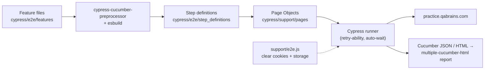

<div align="center">

# 🌲 QA Brains Automation — Cypress + Cucumber

### JavaScript BDD suite for the QA Brains practice site — login, registration, password reset, e-commerce cart, navigation

[](https://git.io/typing-svg)

<!-- ============ STATUS BAR ============ -->
[](https://github.com/rbchy/QaBrainsAutomationCypressJavaScript/actions/workflows/tests.yml)
-22c55e?style=for-the-badge&logo=checkmarx&logoColor=white)


</div>

---

## 📌 At a Glance

<table>
<tr>
<td width="50%" valign="top">

**🙋 What this is**

The **Cypress (JavaScript)** edition of the QA Brains practice-site suite — the same Gherkin scenarios as the [Selenium](https://github.com/rbchy/QaBrainsAutomationJavaSelenium) and [Playwright](https://github.com/rbchy/QaBrainsAutomationJavaPlaywright) editions, run by **`@badeball/cypress-cucumber-preprocessor`** with esbuild bundling. It covers authentication, the **e-commerce demo** (shop login, add / remove to cart, product details, product cards) and the sidebar demo modules.

Every push runs the suite in **GitHub Actions** with headless Chrome.

> *A check that cannot fail is not a check — every assertion here can.*

</td>
<td width="50%" valign="top">

**📍 Quick facts**

| | |
|---|---|
| 🧪 **Scenarios** | 15 in 7 feature files |
| ✅ **CI** | 15 / 15 · headless Chrome · ≈ 90 s |
| 🧱 **Pattern** | Page Objects in `cypress/support/pages` |
| 📊 **Reports** | Cucumber HTML · JSON · multiple-cucumber-html |
| 📸 **On failure** | Cypress screenshots |

</td>
</tr>
</table>

---

## ✅ Latest Results

| Feature file | Scenarios | Result |
|---|---:|---|
| 🛒 `CartCheckout.feature` | 2 |  |
| 🔑 `ForgotPassword.feature` | 2 |  |
| 🔐 `Login.feature` | 2 |  |
| 🚪 `Logout.feature` | 1 |  |
| 📝 `Registration.feature` | 2 |  |
| 🔄 `RegressionTests.feature` | 3 |  |
| 💨 `SmokeTests.feature` | 3 |  |
| **Total** | **15** | **100 % · 1 m 27 s** |

<sub>GitHub Actions, Ubuntu, Node 20, Cypress 13.17, headless Chrome ([workflow](.github/workflows/tests.yml)). The earlier local report ([QaBrainsCypressCucumberReport.pdf](QaBrainsCypressCucumberReport.pdf)) also showed 100 %, but several of its checks could not fail — see the maintenance log.</sub>

---

## 🎯 Test Coverage

<details open>
<summary><strong>🔐 Authentication</strong></summary>

<br>

| Feature | What is asserted |
|---|---|
| Login | Valid login shows the success banner · invalid login shows *"Your email and password both are invalid!"* and no banner |
| Logout | The `?logged=true` flag is gone and the Login button is back |
| Registration | A success message appears · an e-mail without `@` is rejected by the browser (`validity.valid === false`) |
| Forgot Password | Registered e-mail → `?forgot=true` and a success banner · malformed e-mail → the browser's message contains *"missing an '@'"* |

</details>

<details>
<summary><strong>🛒 E-commerce demo</strong></summary>

<br>

| Scenario | What is asserted |
|---|---|
| Add / remove product | The button toggles to *Remove from cart* and back to *Add to cart* |
| R-01 Add multiple products | Each click adds exactly one product; 3 added → 3 in the cart |
| R-02 Product details | Details page shows a `$0.00`-style price and the product name |
| R-03 Product cards | One *Add to cart* button per product; every card has a name, a price and the button |

</details>

<details>
<summary><strong>💨 Smoke</strong></summary>

<br>

| Scenario | What is asserted |
|---|---|
| S-01 | Home page loads |
| S-02 | Registration, Forgot Password, Form Submission and Drag and Drop List each open from the sidebar (URL check) |
| S-03 | The E-Commerce demo site opens from the menu |

</details>

---

## 🏗️ Framework Architecture



- **Clean slate per scenario** — `beforeEach` clears cookies and local storage, so a login in one scenario never leaks into the next
- **Retry-ability instead of sleeps** — assertions like `.should(...)` retry until they pass or time out
- **Page Objects** — locators and actions for Login, Logout, Registration, Forgot Password, Home and the cart in `cypress/support/pages`
- **Single-tab navigation** — links that would open a new tab are kept in the current one, which is how Cypress drives a browser
- **Fixture data** — the site URL and the public practice accounts live in `cypress/fixtures/config.json`

---

## 🛠️ Tech Stack

| Layer | Technology | Version |
|---|---|---|
| Test runner | Cypress | 13.17.0 |
| BDD | `@badeball/cypress-cucumber-preprocessor` | 20.1.2 |
| Bundler | esbuild + `@bahmutov/cypress-esbuild-preprocessor` | 0.20.2 |
| Reporting | Cucumber HTML / JSON, `multiple-cucumber-html-reporter` | 3.10.0 |
| Language / runtime | JavaScript · Node.js | 20 |
| CI | GitHub Actions (`cypress-io/github-action`) | v6 |

---

## 📁 Project Structure

```
QaBrainsAutomationCypressJavaScript/
├── .github/workflows/tests.yml          ← headless Chrome on every push
├── cypress/
│   ├── e2e/
│   │   ├── features/                    ← 7 feature files, 15 scenarios
│   │   └── step_definitions/            ← Common, Login, Logout, Registration,
│   │                                       ForgotPassword, Cart, Smoke, Regression
│   ├── fixtures/config.json             ← URL and public practice accounts
│   └── support/
│       ├── e2e.js                       ← clean state before every scenario
│       ├── commands.js
│       └── pages/                       ← Login, Logout, Registration, ForgotPassword, Cart, Home
├── cypress.config.js                    ← baseUrl, viewport, preprocessor wiring
├── reporter.js                          ← multiple-cucumber-html report
└── package.json
```

---

## ⚙️ Getting Started

**Prerequisites:** Node.js 18+ · Google Chrome

```bash
git clone https://github.com/rbchy/QaBrainsAutomationCypressJavaScript.git
cd QaBrainsAutomationCypressJavaScript
npm ci

npm test                       # all scenarios, headless
npm run open                   # Cypress interactive runner
npm run test:smoke             # @smoke only
npm run test:report            # run, then build the multiple-cucumber-html report
```

| Report | Location |
|---|---|
| Cucumber HTML | `cypress/reports/cucumber-html/cucumber-report.html` |
| Cucumber JSON | `cypress/reports/cucumber-json/` |
| multiple-cucumber-html | built by `node reporter.js` |
| Failure screenshots | `cypress/screenshots/` |

---

## 🧹 Maintenance Log

| Change | Why |
|---|---|
| Smoke steps now assert the sidebar modules open | They looked for Catalog, Blog, Wish List and Refer a Friend, logged *"not found — skipping"* and passed — none of those pages exist |
| Regression steps now drive the real cart and product pages | They asserted `expect(true).to.be.true` |
| *Login successful* checks the success banner | It only required the URL not to contain `login`, which the home page never does |
| *Error shown* checks the exact invalid-login message | It passed if the word "error" appeared anywhere on the page |
| *Logged out* checks the `logged=true` flag and the Login button | It passed if any password field existed — the home page always has one |
| Registration and Forgot Password compare real messages | Success passed on words like "success" anywhere; the error step ignored the expected text |
| GitHub Actions | Every push is checked |

---

## 📈 Roadmap

- [x] Every assertion can fail; GitHub Actions
- [ ] Firefox and Edge in a CI browser matrix
- [ ] Form Submission and Drag and Drop scenarios
- [ ] Publish the multiple-cucumber-html report to GitHub Pages
- [ ] API checks with `cy.request` where the site exposes data

---

## 🔗 Related Projects

| Project | Stack |
|---|---|
| 🧪 [QA Brains — Java + Selenium](https://github.com/rbchy/QaBrainsAutomationJavaSelenium) | Same scenarios on Selenium 4 — CI green |
| 🎭 [QA Brains — Java + Playwright](https://github.com/rbchy/QaBrainsAutomationJavaPlaywright) | Same scenarios on Playwright — CI green |
| ☁️ [QA Brains — Sauce Labs](https://github.com/rbchy/QaBrainsSauceLabAPI_Automation) | Same scenarios, local or Sauce Labs cloud |
| ⭐ [RbcTcsWorld E-Commerce Suite](https://github.com/rbchy/RbcTcsWorld_ECommerceSuite) | Spring Boot · Playwright (TypeScript) · Selenium · CI quality gates |

<sub>All projects: [github.com/rbchy](https://github.com/rbchy)</sub>

---

## 👤 Author

<div align="center">

**Ranajit Baran Chowdhury (RB Chowdhury)**
QA Automation Engineer / SDET · West Norriton, Pennsylvania, USA

[](https://www.linkedin.com/in/rbchy/)
[](https://github.com/rbchy)
[](https://rbchy.github.io/rbchy/)
[](https://rbc6543.wixsite.com/rbc-portfolio)
[](mailto:chyranajit@gmail.com)

<sub>QA Brains is a public practice site; only its published practice accounts are used.</sub>

⭐ *If this project helps you, a star on the repo is appreciated.*

</div>
